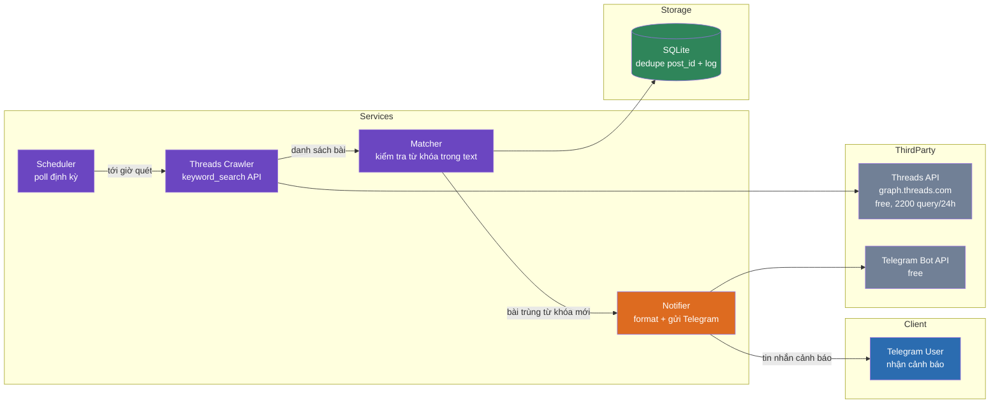

# HLD — Threads Keyword Alert Bot (Threads → Telegram)

> Trạng thái: **Chờ người dùng duyệt** trước khi vào Quy trình 2 (implement).
> Ngày: 25/11/2026

## 1. Bối cảnh nghiệp vụ

Người dùng muốn một bot tự động **lướt Threads theo từ khóa** (VD: `promote`, `free`, `sales`,
`miễn phí AI`, ...). Khi phát hiện bài viết trùng từ khóa, bot gửi cảnh báo về một bot Telegram
của người dùng.

**Scope đã chốt với người dùng:**
- Chỉ theo dõi **Threads** (bỏ X — vì X API 2026 không còn free tier cho developer mới).
- Ngôn ngữ: **Python**.
- Tần suất: **poll định kỳ 3–5 phút** (tùy số lượng từ khóa — xem mục 4).
- Cảnh báo: **gửi mọi bài trùng từ khóa** về Telegram, không lọc thêm theo độ nổi bật.

## 2. Kiến trúc hệ thống



**Luồng xử lý mỗi chu kỳ (mỗi từ khóa):**
1. Scheduler đánh thức Crawler theo chu kỳ quét của từ khóa đó.
2. Crawler gọi `GET /keyword_search` (Threads Graph API) với `search_type=RECENT`,
   `since = <timestamp lần quét trước>`, `limit=100`.
3. Matcher kiểm tra từ khóa xuất hiện trong `text` (case-insensitive) — vì search của Meta là
   ranking/fuzzy, có thể trả về bài không chứa chính xác từ khóa → lọc thêm để giảm nhiễu.
4. Bài qua matcher được kiểm tra dedupe trong SQLite (theo `post_id`): bài đã báo → bỏ qua.
5. Notifier format tin nhắn và gửi về Telegram qua Bot API.

## 3. Công nghệ & thành phần

| Thành phần | Lựa chọn | Ghi chú |
|---|---|---|
| Ngôn ngữ | Python 3.12+ | |
| HTTP client | `httpx` (async) | gọi Threads Graph API + Telegram API |
| Telegram | `python-telegram-bot` v21+ | async, thuần Bot API |
| Lưu trữ | SQLite (stdlib `sqlite3`) | 1 bảng `seen_posts` — đủ cho bot cá nhân, không cần Postgres/Redis |
| Lịch quét | `asyncio` loop + `APScheduler` | tính giờ quét riêng cho từng từ khóa |
| Config | `.env` + `pydantic-settings` | token, chat_id, chu kỳ |
| Từ khóa | `keywords.json` | sửa không cần đụng code |
| Test | `pytest` + `pytest-asyncio` + `respx` (mock HTTP) | coverage ≥ 80% |

**Cấu trúc thư mục dự kiến:**

```
threads-alert-bot/
├── app/
│   ├── main.py              # entrypoint: khởi tạo + chạy scheduler
│   ├── config.py            # settings từ .env
│   ├── keywords.py          # nạp keywords.json
│   ├── threads_client.py    # gọi Threads Graph API (keyword_search, xử lý lỗi/rate limit)
│   ├── matcher.py           # lọc từ khóa trong text
│   ├── storage.py           # SQLite dedupe (seen_posts)
│   └── notifier.py          # format + gửi Telegram
├── data/                    # threads_alert.db (tự sinh)
├── tests/
│   ├── test_matcher.py
│   ├── test_storage.py
│   ├── test_threads_client.py
│   └── test_notifier.py
├── .env.example
├── keywords.json            # danh sách từ khóa mặc định
├── pyproject.toml
└── docs/
    ├── HLD.md               # file này
    └── SETUP.md             # hướng dẫn tạo Meta app + Telegram bot (viết ở task cuối)
```

## 4. Tính toán tần suất quét vs rate limit (QUAN TRỌNG)

Threads giới hạn **2.200 query keyword_search / 24h / mỗi user** (áp chung mọi app, không cộng dồn
theo app). Công thức:

```
queries/ngày = số_từ_khóa × (1440 phút / chu_kỳ_quét_phút)
```

| Số từ khóa | Chu kỳ 3 phút | Chu kỳ 5 phút | Chu kỳ 10 phút |
|---|---|---|---|
| 5 | 2.400 ❌ vượt | 1.440 ✅ | 720 ✅ |
| 8 | 3.840 ❌ | 2.304 ❌ | 1.152 ✅ |
| 10 | 4.800 ❌ | 2.880 ❌ | 1.440 ✅ |
| 15 | — | — | 2.160 ✅ (sát trần) |

**Quy tắc triển khai trong code:** chu kỳ quét tối thiểu được tính tự động từ số từ khóa:
`chu_kỳ = ceil(1440 × số_từ_khóa / 2000)` phút (chừa ~10% biên an toàn). Người dùng vẫn có thể
đặt cứng trong `.env` nếu muốn. **Khuyến nghị bắt đầu: 8–10 từ khóa, chu kỳ 10 phút.**

Ghi chú thêm từ tài liệu Meta:
- Query trả về **0 kết quả không bị tính** vào limit → dùng `since` để hạn chế dữ liệu cũ, nhưng
  query vẫn được tính nếu có kết quả.
- Từ khóa bị Meta coi là nhạy cảm → API trả mảng rỗng (không lỗi).
- `limit` tối đa 100 bài/query.

## 5. Điều kiện tiên quyết (người dùng tự chuẩn bị)

Bot cần 2 thứ trước khi chạy — hướng dẫn chi tiết sẽ nằm trong `docs/SETUP.md`:

1. **Telegram**: tạo bot qua @BotFather → lấy `TELEGRAM_BOT_TOKEN` + `TELEGRAM_CHAT_ID`
   (nhắn bot 1 tin rồi lấy chat_id qua `getUpdates`).
2. **Meta / Threads**:
   - Tạo Meta Developer App (loại Business), thêm sản phẩm **Threads**.
   - Lấy **Threads user access token** qua Graph API Explorer với các quyền
     `threads_basic`, `threads_keyword_search`, `threads_read_replies`.
   - Đổi sang **long-lived token (~60 ngày)** qua endpoint `/oauth/access_token` (cần app secret).
   - Gửi yêu cầu **App Review** cho quyền `threads_keyword_search`.

> ⚠️ **Rủi ro đã biết:** nếu quyền `threads_keyword_search` chưa được Meta duyệt (thường mất vài
> ngày), API chỉ tìm được bài **của chính tài khoản đó**. Giai đoạn chờ duyệt vẫn test được toàn
> bộ pipeline bằng cách đăng bài test chứa từ khóa từ chính tài khoản Threads của bạn.

## 6. Định dạng tin nhắn Telegram

```
🔔 Trùng từ khóa: "miễn phí AI"
👤 @username
🕐 2026-11-25 09:15:00 (UTC+7)
🔗 https://www.threads.com/@user/post/abc123

Nội dung (trích ≤ 280 ký tự):
<text>
```

Có nút inline "Mở trên Threads" (URL button).

## 7. Xử lý lỗi & độ bền

- **Token hết hạn** (60 ngày): log cảnh báo rõ + gửi tin nhắn Telegram báo "token sắp hết hạn"
  (kiểm tra định kỳ 1 lần/ngày), hướng dẫn refresh trong SETUP.md.
- **Rate limit Threads**: nhận lỗi → backoff theo `Retry-After` nếu có, nếu không thì chờ chu kỳ sau;
  không retry vòng lặp nóng.
- **Telegram lỗi gửi**: retry 3 lần (exponential backoff), thất bại → ghi vào bảng `failed_messages`
  để gửi bù chu kỳ sau.
- **Bot dừng đột ngột**: `since` lưu timestamp lần quét cuối trong SQLite → khởi động lại không mất bài
  (chỉ mất bài trong khoảng thời gian bot chết — chấp nhận được với MVP).

## 8. Chiến lược test

- **Unit test** (pytest, mock HTTP bằng `respx`): matcher, storage (CRUD + dedupe), formatter tin nhắn,
  tính chu kỳ quét tự động.
- **Integration test**: pipeline đầy đủ với Threads API fake (respx) + Telegram API fake → verify bài
  mới được gửi đúng 1 lần, bài cũ bị dedupe.
- **E2E thủ công**: chạy bot thật với tài khoản Threads test, đăng bài chứa từ khóa, xác nhận nhận
  tin nhắn Telegram.
- Mục tiêu coverage ≥ 80%.

## 9. WBS (Quy trình 2 — sau khi HLD được duyệt)

| ID | Task | Kết quả |
|---|---|---|
| W1 | Skeleton project: cấu trúc thư mục, pyproject, config, keywords.json | Chạy được `python -m app.main` in config |
| W2 | `threads_client.py`: gọi keyword_search + xử lý lỗi/rate limit | Unit test qua |
| W3 | `storage.py`: SQLite dedupe | Unit test qua |
| W4 | `matcher.py`: lọc từ khóa case-insensitive | Unit test qua |
| W5 | `notifier.py`: format + gửi Telegram | Unit test qua |
| W6 | Scheduler + main: ghép pipeline hoàn chỉnh | Integration test qua |
| W7 | Test suite hoàn thiện, coverage ≥ 80% | Báo cáo coverage |
| W8 | `docs/SETUP.md` + README: hướng dẫn Meta app, App Review, BotFather | Tài liệu hoàn chỉnh |

Mỗi task = 1 commit trên nhánh `develop` (theo git flow của dự án).

## 10. Môi trường DevOps (MVP)

- Chạy local trên Windows: `python -m app.main` (hoặc `docker compose up` nếu muốn sau này).
- Không cần queue/cloud cho MVP; bot là 1 process đơn, chịu được khối lượng này.
- Sau MVP nếu muốn chạy 24/7: đóng gói Docker + deploy lên VPS/RunPod nhỏ (chuẩn bị Dockerfile sẵn
  trong W1).
